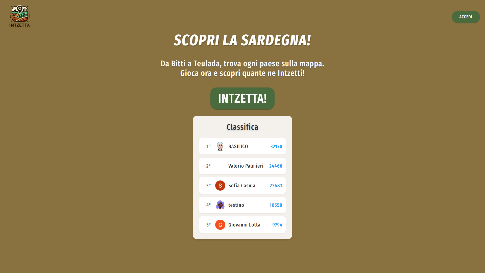
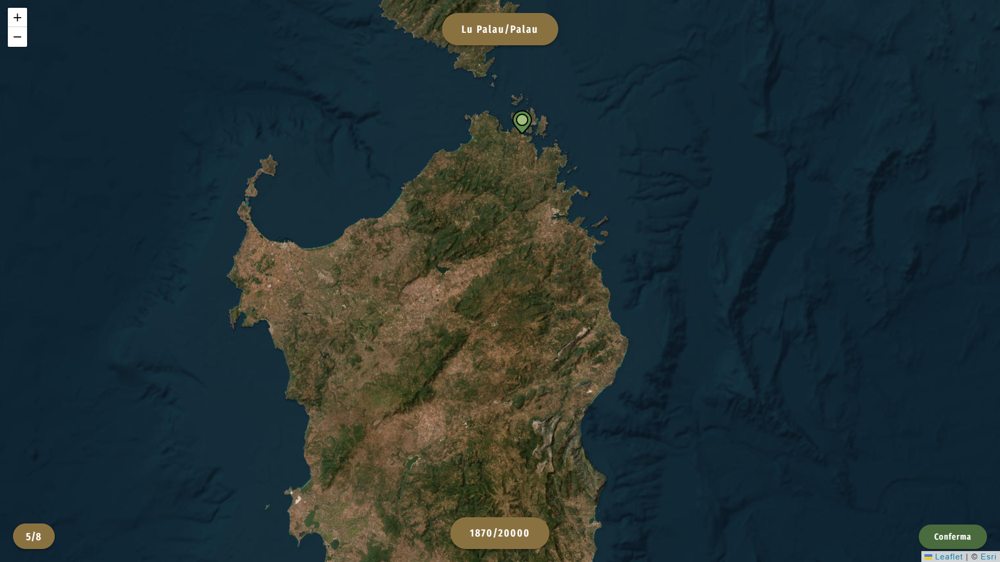
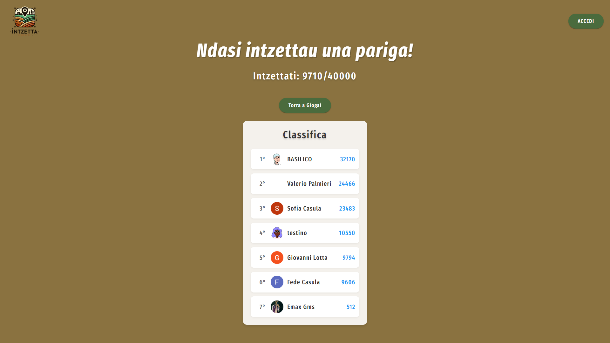

# Intzetta 🎯

**Intzetta** è un gioco di geografia sulla Sardegna: ti viene mostrato il **nome di un paese sardo** e devi
trovarlo **cliccando sulla mappa**. Il punteggio dipende da quanto sei vicino. 8 round, 377 comuni,
fino a 40.000 punti.

**Si gioca qui: [intzetta.top](https://intzetta.top/)**

---

## 📊 Stato del progetto (aggiornato al 14 ottobre 2026)

| | |
|---|---|
| Sito in produzione | [intzetta.top](https://intzetta.top/) (Firebase Hosting, progetto `insetta-b078c`) |
| Account registrati totali | **24**, di cui 21 hanno giocato almeno una partita |
| Prime iscrizioni | 3 maggio 2025 (16 dei 24 account nel primo mese) |
| Ultima attività registrata | 8 maggio 2026 |
| Indicizzazione sui motori di ricerca | **assente** (il sito non compare cercando "intzetta") |
| Misurazione del traffico | **assente** (nessuna analytics attiva) |
| Ricavi | **nessuno** (nessuna pubblicità, nessun prodotto a pagamento) |

Il dato di "account registrati" non conta chi gioca senza fare l'accesso: oggi non è possibile sapere
quante persone aprono il gioco, perché non c'è nessuno strumento di misura. È il primo problema da
risolvere, prima di qualunque ragionamento sui ricavi.

Il piano di crescita e monetizzazione è in **[docs/piano-crescita-e-ricavi.md](docs/piano-crescita-e-ricavi.md)**.

---

## 🚀 Funzionalità

- **Sfida del giorno**: gli stessi 8 comuni per tutti, un solo tentativo al giorno, cambio a mezzanotte
  (fuso di Roma). Selezione deterministica: stessa data, stessa partita per chiunque.
- **Allenamento libero**: partite illimitate con comuni estratti a caso.
- **Risultato condivisibile**: griglia di emoji senza spoiler, più il link, pronto da incollare su WhatsApp.
- **Serie di giorni consecutivi**, salvata anche senza account.
- **Gioco interattivo**: trova i paesi della Sardegna cliccando sulla mappa (mappa satellitare, tile Esri).
- **Punteggio per distanza**: 5.000 punti entro 1 km, 0 punti oltre i 50 km, curva esponenziale in mezzo.
- **Classifica globale**: visibile anche senza account.
- **Miglior punteggio personale** per chi effettua l'accesso.
- **Autenticazione**: Google o email.
- **Ripresa della partita**: ricaricando la pagina a metà sfida si riprende dal round giusto.
- **Design responsivo**: desktop e mobile.

---

## 🛠️ Tecnologie

- **Frontend**: React 18, React-Leaflet, Leaflet, Vite
- **Backend**: Firebase (Authentication, Firestore), Firebase Hosting
- **Mappe**: Esri World Imagery
- **Librerie**: [@turf/turf](https://turfjs.org/) per il calcolo delle distanze, [DiceBear](https://dicebear.com/) per gli avatar

---

## 📂 Struttura del progetto

```
intzetta/
├── docs/
│   ├── piano-crescita-e-ricavi.md   # piano di crescita e monetizzazione
│   └── screenshots/                 # immagini usate nella documentazione
├── public/                          # file statici serviti così come sono
│   ├── comuni-*.html                # GENERATE: i 377 comuni e una pagina per provincia
│   ├── robots.txt                   # indicazioni per i motori di ricerca
│   ├── sitemap.xml                  # GENERATA dall'elenco reale delle pagine
│   ├── og-image.png                 # anteprima del link condiviso (1200x630)
│   ├── favicon-32.png, favicon-192.png, apple-touch-icon.png
│   ├── logo-t.png
│   ├── marker.png                   # segnaposto sulla mappa
│   └── privacy-policy.html, terms-of-service.html
├── scripts/
│   ├── generate-content-pages.mjs   # crea le pagine dei comuni e la sitemap (gira prima di build)
│   ├── fetch-comuni-provinces.mjs   # aggiorna i dati sulle province dall'elenco ufficiale
│   └── test-*.mjs                   # le quattro suite di verifica
├── src/
│   ├── components/                  # Auth, Leaderboard, BestScore, Modal
│   ├── context/AuthContext.jsx
│   ├── data/
│   │   ├── sardinian-cities-corrected.json   # i 377 comuni con coordinate
│   │   └── comuni-provinces.json             # provincia di ogni comune (fonte ISTAT)
│   ├── utils/
│   │   ├── daily.js                 # sfida giornaliera, punteggio, griglia, condivisione, serie
│   │   ├── provinces.js             # raggruppamento per provincia e lettura di ?provincia=
│   │   ├── analytics.js             # misurazione eventi (neutra rispetto al fornitore)
│   │   ├── maptiles.js              # sorgente delle immagini della mappa (configurabile)
│   │   └── db.js                    # letture/scritture Firestore
│   ├── App.jsx                      # stato del gioco: start -> playing -> end
│   ├── daily.css                    # stili della sfida, della condivisione e del riepilogo
│   ├── firebase.js
│   ├── index.css                    # stili di base
│   └── main.jsx
├── firebase.json                    # hosting (cache, header di sicurezza, rewrite)
├── firestore.rules                  # regole di accesso al database
└── vite.config.js
```

---

## 🏁 Come iniziare

### Prerequisiti
- Node.js 18 o superiore
- (solo per il deploy) Firebase CLI: `npm install -g firebase-tools`

### Installazione

1. Clona il repository:
   ```bash
   git clone https://github.com/emaxgms/intzetta.git
   cd intzetta
   ```

2. Installa le dipendenze:
   ```bash
   npm install
   ```

3. Crea un file `.env.local` nella root con la configurazione Firebase del progetto.
   Questi valori sono pubblici per design (viaggiano nel bundle inviato al browser), ma restano
   fuori dal repository perché `.env*` è in `.gitignore`:
   ```
   VITE_FIREBASE_API_KEY=...
   VITE_FIREBASE_AUTH_DOMAIN=...
   VITE_FIREBASE_PROJECT_ID=...
   VITE_FIREBASE_STORAGE_BUCKET=...
   VITE_FIREBASE_MESSAGING_SENDER_ID=...
   VITE_FIREBASE_APP_ID=...
   VITE_FIREBASE_MEASUREMENT_ID=...
   ```
   Puoi recuperarli dalla console Firebase, oppure dalla sezione "Impostazioni progetto" → "Le tue app".

4. Avvia il server di sviluppo:
   ```bash
   npm run dev
   ```
   e apri [http://localhost:3000](http://localhost:3000).

### Deploy
```bash
npm test               # 71 verifiche: date, determinismo, punteggi, serie, condivisione
npm run build          # genera dist/
firebase deploy --only hosting
```
Per pubblicare anche le regole del database:
```bash
firebase deploy --only firestore:rules
```

### Test
```bash
npm test
```
**119 verifiche** in cinque suite:
- **sfida giornaliera** (53): stessa data = stessa partita, nessun comune ripetuto su 400 giorni
  consecutivi, punteggi ai valori limite, cambio di giorno compresi i giorni di 23 e 25 ore per il
  cambio d'ora, serie che cresce e scade, testo di condivisione senza spoiler, comportamento senza
  memoria locale disponibile;
- **province** (24): i conteggi ufficiali tornano, nessun comune in due province, una sigla inventata
  nell'indirizzo viene ignorata, una partita di provincia pesca solo da quella provincia;
- **misurazione spenta** (9): senza configurazione non parte nessun dato e `track()` non lancia mai errori;
- **misurazione accesa** (15): lo script inserito ha gli attributi giusti. Questa suite esiste perché un
  nome di attributo sbagliato (`data-domain` invece di `data-domains`) non rompe nulla a occhio:
  semplicemente non misura;
- **partita completa** (18): dalla selezione dei comuni al risultato salvato, alla serie, al testo
  condiviso finale.

### Misurazione — attiva: Umami
**Deciso e configurato: [Umami](https://umami.is)**, software **open source** (MIT), **senza cookie**
quindi **senza banner di consenso**, con piano gratuito gestito. Se un giorno vuoi il controllo
totale, Umami si installa su un tuo server e i dati restano tuoi.

Gli eventi sono strumentati: `partita_iniziata`, `round_punteggiato`, `partita_finita`,
`condivisione_cliccata`, `sfida_gia_giocata`, `sfida_ripresa`, `allenamento_iniziato`, più la durata.

Configurazione in `.env.local`:
```
VITE_ANALYTICS_PROVIDER=umami
VITE_ANALYTICS_SCRIPT_URL=https://cloud.umami.is/script.js
VITE_ANALYTICS_SITE_ID=7c6bc700-28be-4ea7-83bb-686e6d19784f
VITE_ANALYTICS_DOMAIN=intzetta.top
```

⚠️ **Se il tuo account Umami è nella regione europea**, l'indirizzo dello script è
`https://eu.umami.is/script.js`. Si capisce dall'indirizzo che compare nel browser quando sei nella
dashboard di Umami (`cloud.umami.is` oppure `eu.umami.is`). Con l'indirizzo sbagliato **non viene
registrato nulla**.

Nelle pagine statiche dei comuni il tag di misurazione viene inserito automaticamente dal generatore,
così si vede anche il traffico che arriva dai motori di ricerca. Se la misurazione non è configurata,
le pagine restano **senza nessuna richiesta esterna**.

### Immagini della mappa — da leggere prima di monetizzare
⚠️ Il gioco usa oggi il servizio pubblico World Imagery di Esri **senza chiave**. Funziona, ma i
termini d'uso di Esri **non permettono l'uso commerciale**: niente pubblicità, niente contratti con
enti pubblici, niente self-hosting delle tessere.

La correzione è una variabile d'ambiente, non una modifica al codice. Istruzioni complete in
`src/utils/maptiles.js`.

- **Consigliato: ArcGIS Location Platform** — stesse immagini di oggi, nessun canone, **2.000.000 di
  tessere al mese gratuite** (circa 10.000 partite), poi 0,15 $ per 1.000. Serve solo un token gratuito.
- **Se preferisci zero account e soli dati aperti**: Sentinel-2 cloudless 2016 di EOX, licenza
  **CC BY 4.0**, quindi uso commerciale permesso con attribuzione. Verificato però di persona: a zoom 12
  **non si vedono le strade né i centri abitati**, solo i terreni. Il gioco diventa più difficile.
- **Self-hosting**: non conviene oggi — costerebbe lavoro e darebbe comunque immagini a 10 metri.

### Pagine di contenuto
```bash
npm run content        # rigenera le pagine dei comuni e la sitemap
npm run provinces      # aggiorna i dati sulle province dall'elenco ufficiale (ISTAT)
```
Gira automaticamente prima di ogni `npm run build`. Vengono create la pagina generale dei **377 comuni**
e **una pagina per provincia** (Cagliari 17, Nuoro 74, Oristano 87, Sassari 92, Sud Sardegna 107), più
la sitemap. Ogni pagina di provincia ha un pulsante che avvia una partita **con i soli comuni di quella
provincia** (`/?provincia=SS`).

Se un comune non finisce in una pagina, la compilazione **si interrompe** invece di pubblicare un
elenco incompleto: è già successo una volta, con un comune scritto `'Onne` invece di `Onne`.

---

## 📸 Screenshot

### Pagina iniziale


### Gioco in corso


### Classifica


---

## 🧩 Come funziona il codice

### **`App`**
Gestisce lo stato del gioco (`start`, `playing`, `end`) e coordina `StartPage`, `Game` ed `EndPage`.

### **`StartPage`**
Pagina iniziale con introduzione, pulsante di avvio, classifica e miglior punteggio.

### **`Game`**
La logica di gioco: estrae un comune non ancora usato, raccoglie il clic sulla mappa, calcola la
distanza con turf e assegna il punteggio (decadimento esponenziale, 5.000 punti entro 1 km).
Si può confermare anche con la barra spaziatrice.

### **`EndPage`**
Punteggio finale, messaggio in sardo in base al risultato, classifica e possibilità di rigiocare.

### **Punteggio**
`calcScore()` in `src/App.jsx`: massimo 5.000 punti entro 1 km, 0 punti oltre 50 km, curva
esponenziale in mezzo. Il massimo di una partita da 8 round è quindi 40.000.

---

## 📄 Licenza

Al momento **non è concessa alcuna licenza d'uso**: il repository è pubblico ma tutti i diritti
restano riservati al titolare. Nota: la versione precedente di questo README dichiarava licenza MIT,
ma nel repository non è mai esistito un file `LICENSE` e il campo `license` di `package.json`
indicava `ISC`: la dichiarazione MIT è stata rimossa perché non corrispondeva ai fatti.

La scelta della licenza è una decisione aperta ed è discussa nel piano
(sezione "Licenza e diritto d'autore"): va presa prima di rendere pubblico il motore riutilizzabile.

---

## 🤝 Contributi

Segnalazioni e suggerimenti sono benvenuti: apri una
[issue](https://github.com/emaxgms/intzetta/issues) o invia una pull request.

---

## 📧 Contatti

**emavacca00@gmail.com** — Instagram [@emavacca](https://www.instagram.com/emavacca)

---

**Intzetta** — Scopri la Sardegna, un click alla volta. 🌍
